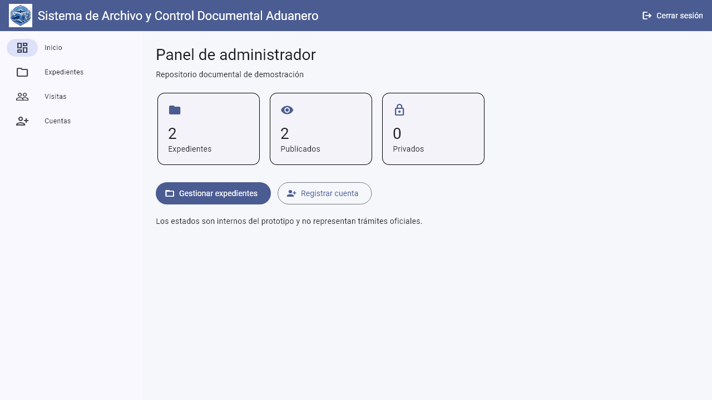
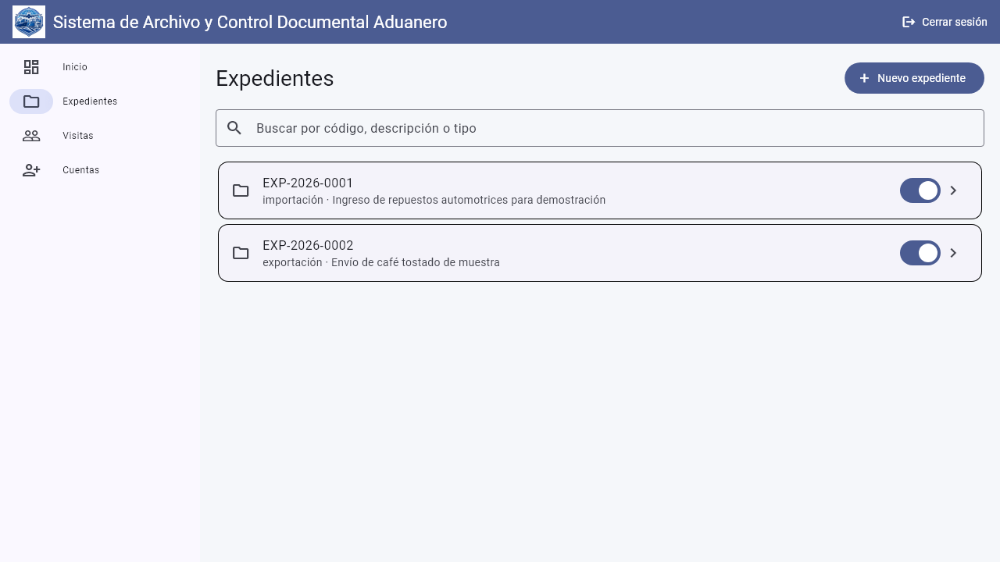
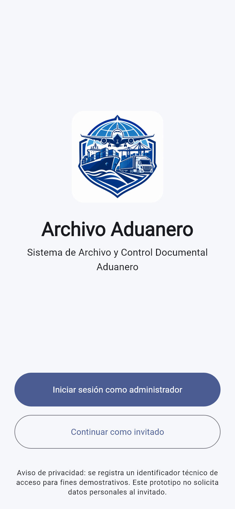
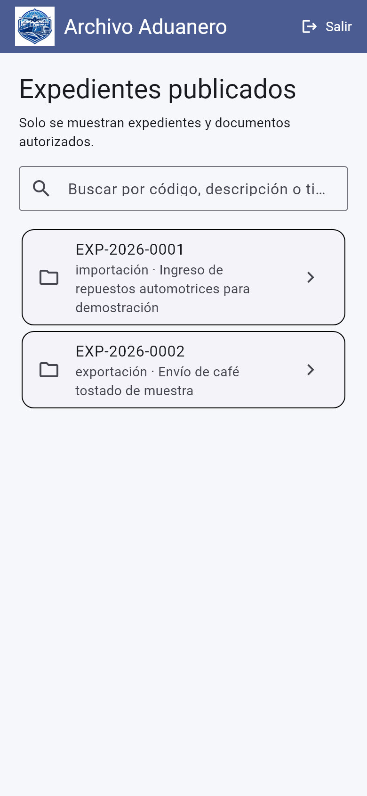
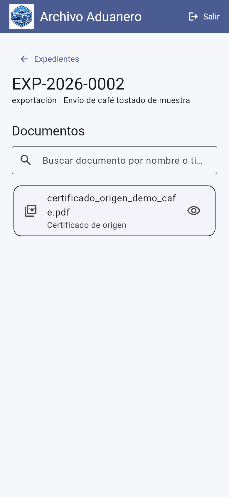
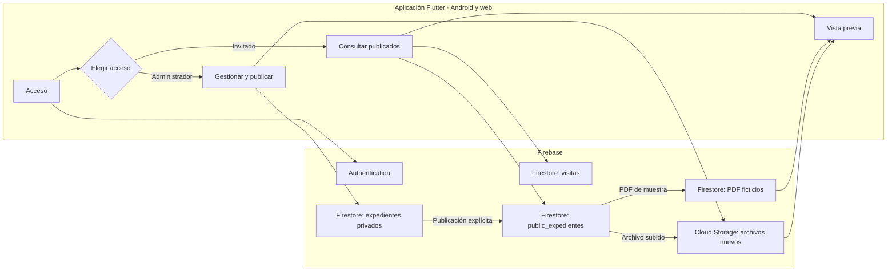

<p align="center"></p>

# Sistema de Archivo y Control Documental Aduanero

Aplicación Flutter en español para organizar expedientes de importación y exportación, publicar documentos de muestra y consultar un archivo documental desde Android o PC.

**Estado:** prototipo académico y de portafolio. **Autor:** [Javier David Ortega Herrera](https://github.com/javierdavidortegaherrera-ui), estudiante de Ingeniería en Informática en CEUTEC, Honduras.

Es un proyecto independiente, sin afiliación con empresas o instituciones aduaneras ni integración con servicios gubernamentales. Usa únicamente expedientes y documentos ficticios de demostración.

## Vista de la aplicación

Las capturas se generaron con pruebas de widgets Flutter y datos ficticios. Las imágenes Android reproducen el tamaño de una pantalla móvil; no son fotografías ni grabaciones de un teléfono físico.

| PC: administrador | PC: expedientes |
|---|---|
|  |  |

| Android: acceso | Android: expedientes | Android: documentos |
|---|---|---|
|  |  |  |

## Demostraciones

| PC | Android |
|---|---|
| [](docs/demo/pc-demo.mp4) | [](docs/demo/android-telefono.mp4) |

[Video de PC](docs/demo/pc-demo.mp4) · [Video real de Android](docs/demo/android-telefono.mp4). El video de PC es una secuencia de capturas generadas por pruebas de widgets. El de Android se grabó en un teléfono conectado por USB: muestra la consulta de un expediente publicado y la apertura de su PDF ficticio como invitado. Las capturas estáticas anteriores también se generaron con pruebas de widgets. [Detalles y reproducción del material visual](docs/demo/README.md).

Los PDF de muestra también son ficticios: [factura comercial](output/pdf/factura_comercial_demo_repuestos.pdf) y [certificado de origen](output/pdf/certificado_origen_demo_cafe.pdf). No tienen validez comercial, legal ni aduanera.

## Diagrama interactivo: cómo funciona

El diagrama aparece aquí mismo. Puedes contraerlo o expandirlo y abrir los recorridos de invitado, administrador y permisos que aparecen debajo.

<details open>
<summary>Mapa visual del sistema</summary>

El mapa separa la aplicación de los servicios de Firebase.



</details>

[**Abrir el archivo del visor interactivo**](docs/arquitectura-interactiva.html) para elegir la ruta del invitado, del administrador o de seguridad y pulsar cada módulo para ver su función y sus archivos. En GitHub, usa **Download raw file** para descargar el HTML y ábrelo en tu navegador; GitHub no ejecuta sus controles dentro del README.

[**Explorar el diagrama interactivo en línea**](https://htmlpreview.github.io/?https://github.com/javierdavidortegaherrera-ui/sistema-archivo-documental/blob/main/docs/arquitectura-interactiva.html) mediante una vista externa del archivo público. Elige **Vista general**, **Ruta del invitado**, **Ruta del administrador** o **Datos y permisos**, y pulsa un módulo para ver su función y los archivos relacionados.

Noodles se conectó, pero no generó un grafo de este repositorio porque su analizador no admite Dart. Este visor es una alternativa interactiva elaborada a partir del código Flutter y las reglas de Firebase.

<details>
<summary>👤 Ruta del invitado: entrar, buscar y abrir un documento</summary>

1. Entra con una sesión anónima de Firebase Authentication; la aplicación registra una visita técnica en `registros_invitados`.
2. Consulta `public_expedientes` y elige un expediente y un documento publicados.
3. Abre el PDF ficticio guardado en Firestore o un archivo nuevo autorizado en Cloud Storage.

[Acceso](lib/screens/acceso/pantalla_acceso.dart) · [Servicio de acceso](lib/services/acceso_service.dart) · [Expedientes y vista previa](lib/screens/expedientes/panel_expedientes.dart)

</details>

<details>
<summary>🗂️ Ruta del administrador: crear, subir y publicar</summary>

1. Inicia sesión con correo y contraseña. La aplicación comprueba el *custom claim* o el registro protegido en `administradores/{uid}`.
2. Crea un expediente privado en Firestore. Con Cloud Storage habilitado, puede subir PDF, JPG o PNG de hasta 10 MB; los metadatos se guardan en Firestore.
3. Publica primero el expediente y después el documento. La aplicación crea la versión visible para invitados en `public_expedientes`.
4. Desde el panel puede revisar visitas y registrar otra cuenta administrativa.

[Control de sesión](lib/app/aplicacion.dart) · [Operaciones del archivo](lib/repositories/archivo_repository.dart) · [Panel](lib/screens/inicio/pantalla_inicio.dart) · [Cuentas](lib/screens/acceso/pantalla_cuentas.dart)

</details>

<details>
<summary>🔒 Datos y permisos: qué se puede leer</summary>

| Recurso | Administrador | Invitado |
|---|---|---|
| Expedientes y documentos privados | Gestiona | Sin acceso |
| Expedientes y documentos publicados | Gestiona | Consulta |
| PDF ficticios de muestra | Consulta | Consulta si están publicados |
| Archivos nuevos en Cloud Storage | Sube y consulta | Consulta si están publicados |

Las reglas protegen las lecturas y escrituras; ocultar un documento también debe retirar su acceso público. [Reglas de Firestore](firestore.rules) · [Reglas de Storage](storage.rules) · [Operaciones de lectura y publicación](lib/repositories/archivo_repository.dart).

</details>

## Objetivo

Organizar expedientes de importación y exportación, guardar PDF e imágenes en la nube y permitir que un invitado vea solo lo publicado por un administrador. Resuelve la dispersión de archivos y la falta de una vista clara sobre qué documentos se pueden consultar.

## Funciones

- Una aplicación Flutter para Android y web, con Material 3 y el logotipo original en `assets/images/logo_aduanero.png`.
- Acceso Email/Password para administradores preautorizados y acceso anónimo sin registro para invitados. Desde la sección **Cuentas**, un administrador puede registrar otra cuenta administrativa sin cerrar su propia sesión.
- Alta y listado de expedientes con código `EXP-AÑO-NNNN`, generado con contador transaccional en Firestore.
- Carga de PDF, JPG y PNG de hasta 10 MB, con comprobación de extensión y firma básica del contenido. Para subir archivos nuevos se necesita un bucket de Cloud Storage habilitado.
- Metadatos en Firestore, archivo en Cloud Storage y vista previa en la aplicación.
- Dos PDF ficticios pequeños de demostración, asociados a `EXP-2026-0001` y `EXP-2026-0002`, se leen directamente desde Firestore para que los invitados puedan probar la vista previa antes de habilitar Cloud Storage. Los originales están en `output/pdf/`. Esta excepción no se usa para archivos nuevos.
- La vista PDF web usa PDF.js 4.6.82 incluido localmente en `web/pdfjs` bajo su licencia Apache 2.0; la visualización no carga código desde una CDN.
- Publicación u ocultación explícita de expedientes y documentos. Ambos son privados por defecto.
- Búsqueda simple por campos de los registros ya autorizados en la pantalla actual; no es búsqueda de texto completo.
- Pantallas de carga esqueleto en el acceso, panel, listados, cuentas y vista previa de documentos. La animación respeta la preferencia del sistema para reducir movimiento.
- Registro técnico de accesos anónimos y panel de las 50 visitas recientes para administradores.
- Reglas de Firestore y Storage que reservan las escrituras de negocio al administrador inicial con custom claim `admin` y a cuentas registradas en la colección protegida `administradores`. Los invitados solo pueden leer archivos de una versión publicada bajo un expediente publicado.

El archivo se sube primero a Storage y después se confirman sus metadatos en un lote de Firestore. Si falla Firestore, la aplicación intenta borrar el archivo. Una interrupción entre ambos servicios aún puede dejar un archivo huérfano privado, que deberá limpiar un administrador.

## Estructura

**Tecnologías:** Flutter/Dart, Material 3, Firebase Authentication, Cloud Firestore, Cloud Storage, SharedPreferences y PDF.js para vista previa web.

```text
lib/
  app/             aplicación, tema y control de sesión
  core/            configuración y validación de archivos
  models/          expedientes y documentos
  repositories/    operaciones Firestore y Storage
  services/        autenticación y registro de visitas
  screens/         acceso, inicio, expedientes y documentos
assets/images/     logotipo original
firestore.rules     permisos de datos
storage.rules       permisos de archivos
```

Los datos se guardan en Firebase, no en carpetas del dispositivo. Una reinstalación o borrado de datos locales no borra expedientes, documentos ni registros remotos. El `installationId` es aleatorio y local: si se borran los datos o se usa navegación privada, se puede crear una identidad técnica nueva. No se usan IMEI, MAC ni huellas del navegador. El registro de invitado escrito desde el cliente es un registro técnico de demostración, no una auditoría infalsificable. Las capturas usan datos inyectados en pruebas: al clonar el código no se copian cuentas ni documentos de Firestore.

## Preparar Firebase

1. Crea un proyecto Firebase propio con datos ficticios. Registra una app Android con ID `hn.portafolio.archivodocumentaladuanero` y una app Web. La configuración pública de las apps no es una credencial de servidor.
2. En **Authentication > Sign-in method**, habilita **Email/Password** y **Anonymous**. En **Authentication > Settings > Authorized domains**, añade `localhost` para pruebas web locales y el dominio donde publicarás la web, si corresponde. Los proyectos nuevos pueden no incluir `localhost` por defecto.
3. Crea Firestore en modo de reglas cerradas y un bucket de Cloud Storage para subir archivos nuevos. **Cloud Storage for Firebase requiere el plan Blaze**; revisa sus cuotas y configura un presupuesto antes de habilitarlo. Los dos PDF ficticios pequeños de demostración pueden visualizarse sin ese bucket. El código no agrega Cloud Functions ni otros servicios de backend.
4. Copia `firebase.local.example.json` a `firebase.local.json` y completa los valores de las configuraciones de tus apps: la API key de Android (`current_key` en `google-services.json`), la API key web (`apiKey` del objeto de configuración), project ID, sender ID, bucket, app ID Android, app ID Web y auth domain. El archivo local está excluido de Git. No pongas contraseñas ni claves de servicio allí.
5. Instala Firebase CLI e inicia sesión en tu proyecto. Despliega **ambas** reglas desde esta carpeta con `firebase deploy --only firestore:rules,storage`. Al usar consultas de Firestore desde Storage Rules, Firebase puede solicitar habilitar el permiso de conexión entre ambos productos. Revisa la solicitud en la consola y confírmala para tu proyecto.
6. Para la vista previa web, configura CORS del bucket porque `getData()` descarga los bytes directamente. El ejemplo `storage.cors.example.json` permite solo solicitudes GET desde cualquier origen; antes de publicar una web, limita `origin` a sus dominios. Ejecuta `gsutil cors set storage.cors.example.json gs://<TU_BUCKET>` con Google Cloud CLI. CORS no concede acceso: las reglas de Storage siguen autorizando cada lectura. Consulta la [guía oficial de descarga web](https://firebase.google.com/docs/storage/web/download-files#cors_configuration).
7. Crea una cuenta Email/Password de demostración desde la consola Firebase, nunca desde un formulario público. Asigna el custom claim administrativo desde un entorno de confianza. El script incluido usa Application Default Credentials y requiere `pnpm install`, `GOOGLE_APPLICATION_CREDENTIALS` apuntando a una credencial **fuera del repositorio**, `GOOGLE_CLOUD_PROJECT` y `pnpm asignar-admin <UID>`. El operador debe verificar que el UID corresponde a la cuenta Email/Password deseada. Después, cierra e inicia sesión para renovar el token.

Después de entrar con esa cuenta inicial, abre **Cuentas > Registrar cuenta**. El formulario crea otra cuenta Email/Password en una instancia secundaria de Firebase Auth y escribe su permiso en Firestore. La sesión del administrador permanece abierta. Las cuentas nuevas tienen acceso administrativo; comparte la contraseña por un medio apropiado y cámbiala si deja de ser privada. La clave de servicio nunca se incluye en la app.

Las reglas se bloquean por defecto en rutas no declaradas. No publiques un bucket con reglas abiertas. Nunca subas la credencial administrativa, documentos reales o contraseñas a GitHub. El proyecto incluye `.gitignore` para los archivos de configuración local y credenciales con los nombres indicados.

## Ejecutar

Requiere Flutter compatible con Dart 3.13 y Android SDK para compilar Android.

```bash
flutter pub get
flutter run -d chrome --dart-define-from-file=firebase.local.json
flutter run -d android --dart-define-from-file=firebase.local.json
```

En Android, usa un emulador con Google Play o un dispositivo compatible. Si falta la configuración, la aplicación muestra una pantalla con los pasos a seguir. El logotipo ya está copiado y declarado en `pubspec.yaml`; los iconos Android y web se generaron a partir del mismo emblema con margen blanco, sin recortar avión, barco ni camión.

## Comprobar el flujo

1. Inicia sesión como administrador y crea un expediente ficticio.
2. Ábrelo, sube un PDF de prueba y comprueba la vista previa. Revisa en Firebase Console el documento de Firestore y el archivo de Storage.
3. Publica el expediente y luego el documento.
4. En otra sesión o navegador, entra como invitado. Comprueba que el expediente y el PDF aparecen y pueden visualizarse.
5. Oculta el documento y comprueba que desaparece y que su ruta de Storage deja de ser legible por el invitado. Repite con un documento privado desde el inicio.
6. Intenta escribir directamente en Firestore con un token anónimo: las reglas deben denegar escrituras de expedientes y documentos. El invitado solo puede crear o actualizar su propio `registros_invitados/{uid}` con los campos permitidos.
7. Comprueba desde otra instalación de administrador que el mismo expediente sigue visible. Borrar datos locales no debe borrar información remota.

Estas comprobaciones de Firebase requieren un proyecto configurado. Para probar permisos sin tocar producción, usa Firebase Local Emulator Suite con `firestore.rules` y `storage.rules` de este repositorio.

## Análisis y pruebas locales

```bash
flutter analyze
flutter test
flutter build web --dart-define-from-file=firebase.local.json
flutter build apk --debug --dart-define-from-file=firebase.local.json
```

La prueba incluida comprueba aceptación y rechazo de firmas de archivos. Las pruebas de reglas, el flujo remoto, la persistencia después de reinstalación y las capturas reales requieren Firebase o emuladores configurados.

## Material visual

Las capturas estáticas y el video de PC se generaron mediante pruebas de widgets con datos ficticios. El video de Android es una grabación real del modo invitado y muestra la lectura de un PDF ficticio desde el proyecto Firebase de demostración. El flujo administrativo completo y la carga de archivos nuevos requieren un bucket de Cloud Storage configurado.

## Limitaciones y siguientes fases

Este MVP no incluye edición/archivo de expedientes, checklist, reemplazo y consulta de versiones, historial de actividad ni filtros avanzados. El modelo guarda una primera versión para ampliar el flujo posteriormente. No valida autenticidad de documentos, requisitos legales, tributos ni estados oficiales. La vista previa no impide copiar o capturar el contenido. Los identificadores técnicos de invitados pueden cambiar al reinstalar la app o limpiar el navegador.

No hay sincronización automática con GitHub ni despliegue público incluido. Antes de publicar una demo, verifica las reglas en emuladores y con cuentas de prueba, sube solo datos ficticios y revisa costos de Firebase.
